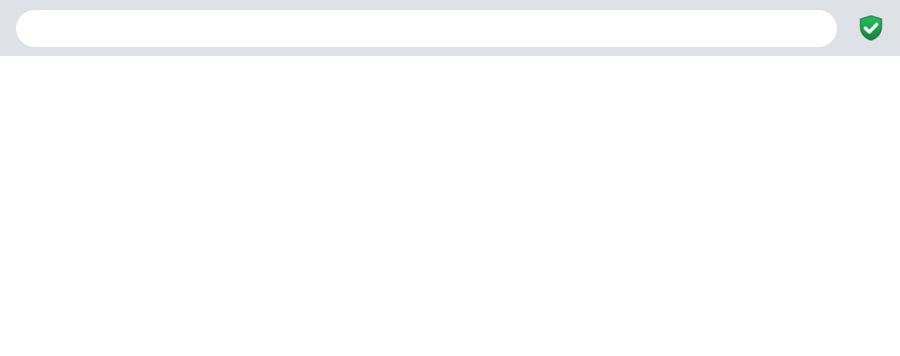

# RealSite

[](https://github.com/giatruong1/RealSite/actions/workflows/test.yml)

A browser extension that warns you **before** a fake lookalike site loads, such as `go0gle.com` instead of `google.com` or `paypa1.com` instead of `paypal.com`.

It runs in the background whenever the browser is open. Nothing to start, no account, no build step.



## Install

The extension isn't in a store yet, so you load it from this folder.

1. Download the code: **Code → Download ZIP** on GitHub and unzip it, or run `git clone https://github.com/giatruong1/RealSite.git`.

**Chrome, Brave, Edge**

2. Open `chrome://extensions` (in Brave use `brave://extensions`, in Edge `edge://extensions`).
3. Turn on **Developer mode** (top right).
4. Click **Load unpacked** and pick the `RealSite` folder.
5. Optional: click the puzzle-piece icon in the toolbar and pin RealSite.

**Firefox**

2. Open `about:debugging#/runtime/this-firefox`.
3. Click **Load Temporary Add-on** and pick `manifest.json`.

Firefox removes temporary add-ons when it restarts.

**Try it:** type `go0gle.com` in the address bar. You should get the RealSite warning page instead of the site.

## How it decides

Every page you open goes through three checks:

1. **Known brands (offline, instant).** Compares the domain against about 140 well-known sites in [`domains.js`](domains.js). It catches:
   - swapped lookalike characters: `0`→`o`, `1`→`l`, `rn`→`m`, Cyrillic or Greek letters that look like Latin ones
   - one-letter typos: `gooogle.com`, `googel.com`
   - a nearby ending: `paypal.co` instead of `paypal.com`
   - a real brand hidden at the front: `google.com.login-check.ru`
2. **Your own sites (offline).** Any domain you've visited 10+ times in your browser history counts as real. Lookalikes of those get the same checks as step 1. So your bank is protected even if it isn't in the list.
3. **Unknown domains (online).** Looks up the domain's registration date in the public RDAP registry:
   - registered less than 30 days ago → warning
   - less than a year old, and its cleaned-up spelling (`myc0olbank.com` → `mycoolbank.com`) is an older registered domain → warning

The warning page gives three choices: go to the real site, go back, or **I trust this site**. Trusting a site remembers it and skips the warning next time.

## Privacy

- Steps 1 and 2 never leave your computer. Your history is read locally and is never sent anywhere.
- Step 3 sends only the bare domain name (for example `example.com`, never the full URL) to [rdap.org](https://rdap.org) and that domain's registry. Each domain is looked up once, then the result is cached.
- No tracking, no analytics, no account.

To turn off online lookups completely, set `ONLINE = false` at the top of [`background.js`](background.js).

## Customize

| Want to… | Change |
|---|---|
| Protect another site | Add it to [`domains.js`](domains.js) |
| Change how many visits make a site "yours" | `MIN_VISITS` in [`background.js`](background.js) |
| Stop online lookups | `ONLINE = false` in [`background.js`](background.js) |
| Change the logo | Edit [`icons/icon.svg`](icons/icon.svg), then run `cd icons && for s in 16 32 48 128; do rsvg-convert -w $s -h $s icon.svg -o icon$s.png; done` |

After any change, click the reload arrow on RealSite in your extensions page.

## Test

```bash
node test.mjs
```

It prints `ok` when every detection rule passes. Needs Node 18 or newer.

GitHub Actions runs the same test on every push ([`.github/workflows/test.yml`](.github/workflows/test.yml)). The badge at the top shows the latest result.

## Known limits

- It protects only the browser it's installed in, not other apps on your computer.
- Online lookups take a moment, so for a brand-new domain the page can appear briefly before the warning replaces it.
- Some country domains (such as `.de` and `.ru`) have no RDAP registry, so step 3 can't check them.
- Typos in short names (under 6 letters, such as `appel.com`) aren't flagged, because that would also flag real sites like `apply.com`.
- An old scam domain with an original name, one that doesn't imitate a known site, passes.

## Files

| File | What it does |
|---|---|
| `manifest.json` | Extension settings and permissions |
| `background.js` | Watches each page you open and runs the three checks |
| `detect.js` | Lookalike detection rules (no browser APIs, so Node can test it) |
| `domains.js` | Built-in list of protected sites |
| `warning.html`, `warning.js` | The warning page |
| `test.mjs` | Self-check for the detection rules |
| `flow.html` | Diagram of how a visit flows through the checks |
| `demo.gif` | The demo at the top of this page |
| `.github/workflows/test.yml` | Runs the tests on GitHub for every push |
